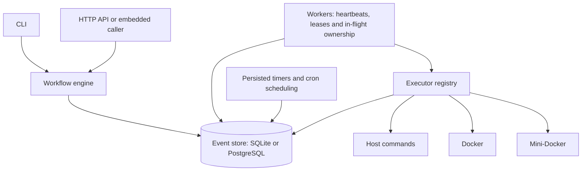

# DuraFlow

[](https://github.com/Yumekaz/DURAFLOW/actions/workflows/verification.yml)

**A local-first durable workflow engine for multi-step backend operations.**

Define operations in YAML, persist their progress in SQLite or PostgreSQL, and execute them through host commands, Docker or Mini-Docker. DuraFlow provides dependency ordering, retries, timers, cron schedules, worker leases, cancellation and compensation.

[Cairn](https://github.com/Yumekaz/Cairn) embeds DuraFlow to coordinate stateful deployment and recovery.

## Capabilities

| Area | Behavior |
| --- | --- |
| Workflow definitions | Named, versioned YAML workflows with step dependencies |
| Persistence | SQLite for local use; PostgreSQL for a shared event store |
| Execution | Host, Docker and Mini-Docker executor backends |
| Recovery | Durable events and step state, worker heartbeats and leases |
| Retry policy | Attempts, fixed/exponential backoff and exit-code filters |
| Scheduling | Persisted waits/timers and cron schedules with overlap policy |
| Failure handling | Cancellation, explicit retry/resume and compensating commands |
| Inspection | CLI status/events/logs and an HTTP API |

## Quick start

Requirements: Go **1.26.4 or a compatible newer toolchain**. The hello workflow uses ordinary host shell commands; container executors require their respective runtimes.

```bash
git clone https://github.com/Yumekaz/DURAFLOW.git
cd DURAFLOW
mkdir -p bin
go build -o bin/duraflow ./cmd/duraflow

./bin/duraflow --db ./demo.sqlite run examples/hello.yaml
./bin/duraflow --db ./demo.sqlite list
```

Use the run ID printed by the first command:

```bash
./bin/duraflow --db ./demo.sqlite status "<run-id>"
./bin/duraflow --db ./demo.sqlite events "<run-id>"
./bin/duraflow --db ./demo.sqlite logs "<run-id>"
```

## Define a workflow

The [hello example](examples/hello.yaml) demonstrates dependency ordering:

```yaml
name: hello
version: 1
steps:
  - id: greet
    run: "echo 'Hello from DuraFlow!'"
  - id: timestamp
    run: "date -u '+%Y-%m-%dT%H:%M:%SZ'"
    depends_on: [greet]
```

Steps can also declare `timeout_ms`, `retry`, `idempotency_key`, `compensation`, `wait` and an `executor`. The [definition types](pkg/workflow/types.go) and [examples](examples) describe the actual schema.

## Architecture



The event store holds definitions, runs, step state, events, leases and scheduling data. Executors perform external work; the engine/worker records its outcome in durable state.

## Workers, scheduling and PostgreSQL

Start a worker against the same event store:

```bash
./bin/duraflow --db ./demo.sqlite worker start
```

Inspect registered cron schedules or expose the local API with an in-process worker:

```bash
./bin/duraflow --db ./demo.sqlite cron list
./bin/duraflow --db ./demo.sqlite server --addr 127.0.0.1 --port 8080 --worker
```

A `--db` value beginning with `postgres://` or `postgresql://` selects PostgreSQL. For a database URL configured in your environment:

```bash
./bin/duraflow --db "$DURAFLOW_DATABASE_URL" worker start
```

Use a dedicated database and appropriate connection security. The HTTP API should remain local unless a separately secured access layer is provided.

## Recovery and execution semantics

- Durable progress lets unfinished work be resumed after process loss.
- Lease claims preserve succeeded steps instead of resetting them after stale scans; deliberate compensation is a separate eligible execution path.
- A worker reserves an in-flight step before claiming its lease, preventing duplicate dispatch by that worker after a stale heartbeat.
- Retries and crash recovery can still repeat **external side effects** when their outcome was not durably recorded. Use replay-safe commands and external idempotency keys where needed.
- An idempotency key is not a universal exactly-once guarantee across arbitrary external systems.
- Compensation is a command, not an ACID transaction or automatic reversal of every side effect.

```bash
./bin/duraflow --db ./demo.sqlite resume "<run-id>"
./bin/duraflow --db ./demo.sqlite retry "<run-id>"
./bin/duraflow --db ./demo.sqlite cancel "<run-id>"
```

Inspect state and command side effects before choosing recovery actions.

## Verification

```bash
go test ./...
```

Database/runtime prerequisite skips are not proof of those paths. To execute the real PostgreSQL tests against a dedicated database:

```bash
DURAFLOW_TEST_POSTGRES_DSN="$DURAFLOW_DATABASE_URL" go test ./pkg/store -run Postgres -count=1
```

The required [Verification workflow](.github/workflows/verification.yml) runs real PostgreSQL tests, worker/store race detection and three privileged Mini-Docker executor cases. The latter uses a pinned sibling runtime and disposable BusyBox rootfs fixtures; prerequisite skips fail that gate.

The October 14 verification covered five real PostgreSQL cases and deterministic regressions for terminal-step replay and duplicate in-flight execution. See [Cairn's retained validation record](https://github.com/Yumekaz/Cairn/blob/main/docs/VALIDATION_2026-10.md) for cross-project recovery evidence and limitations.

## Source map

[Workflow schema](pkg/workflow) · [Engine](pkg/engine) · [Worker](pkg/worker) · [Stores](pkg/store) · [Executors](pkg/executor) · [API](pkg/api) · [Examples](examples)
